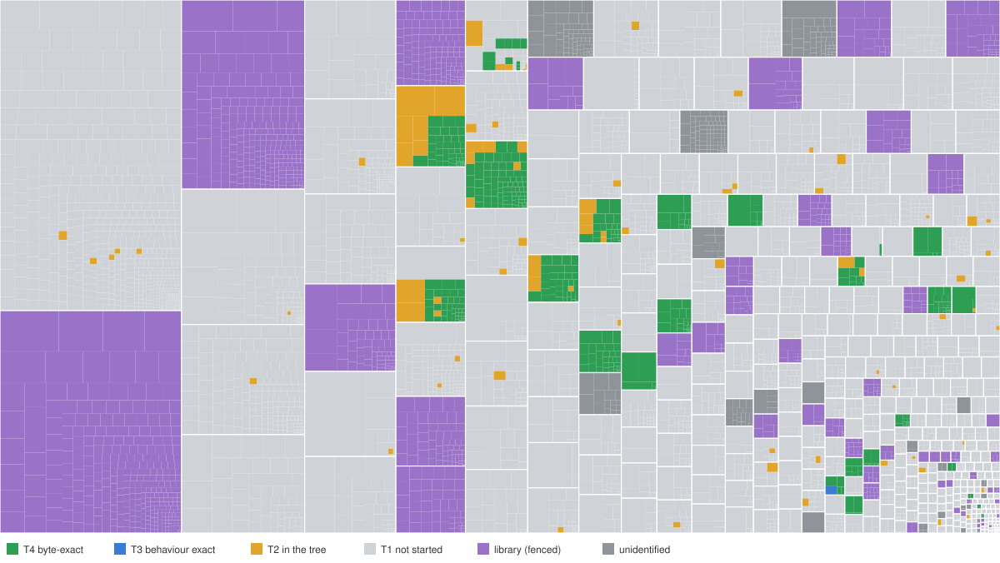

# Ridge Racer (PSP): decompilation

**Started October 12, 2026.** The retail executable is mapped and its compiler is identified. A per-function grader compiles C with that compiler and compares it to the original bytes. On a random control set of 61 retail functions, 49 already compile to identical bytes.

No game function has been filed into the tree yet, so both milestones stand at zero (see [Current Status](#current-status)).

**Maintainer:** Jeffrey Wilbur, Strut B, LLC\
**Contact:** [retro@strutb.com](mailto:retro@strutb.com)

## Project Purpose

This is a decompilation of **Ridge Racer** (PSP, 2004/2005), held to the MAME standard:

- Every function is rewritten as readable C++ or C.
- Every function is documented with what it does.
- Every function is filed into the source file it came from.
- Every function is proven against the original.

There are two proofs. The source must compile under the original compiler to **byte-identical output**, and code that is not yet byte-exact must be **certified to behave exactly like the original**.

Progress is measured only by those two proofs. Playability is a consequence, never a reason to reorder the work.

## Game background

Namco shipped *Ridge Racer* as a PSP launch title: *Ridge Racers* in Japan in December 2004, then North America and Europe in 2005. All three regions run one program, `PSP_GAME/SYSDIR/BOOT.BIN`, which is an unencrypted ELF.

The binary keeps a great deal of its build:

- **The compiler.** The program is a relocatable PSP module that carries its **full relocation tables** (78,287 entries). Every reference from code to code or data is known exactly.
- **The build's object files.** A `.comment` ident survives for each of the **493 object files** in link order. They name the compiler: SCE's `GCC 3.3.3+allegrex-2.2.1-psp-1.5.1`.
- **The code.** The game is C++ with RTTI and exceptions. It has 3,977 exception-frame records that give exact function extents, and 154 surviving class names such as `Fj::C2DAnalogMeter`, `Car::CCarBufferPSP` and `RRBios::TextureManager`.
- **The libraries.** Sony's system libraries, newlib and GCC's runtime are linked in statically.

Each region's signed `EBOOT.BIN` decrypts to exactly its `BOOT.BIN`, which `tools/refcheck.py --eboot` checks. The reference is therefore the program the PSP actually runs. The USA and Europe executables differ by 5 bytes. The Japanese release is a separate, earlier build.

## The compiler

The exact SCE 1.5.1 toolchain is not public. The two neighbouring SCE builds that are public, psp-gcc 1.3.1 and 1.7.1 from decomp.me's compiler archive, produce identical instructions on every function tested.

Retail differs from both of them in exactly one way that has been found: it contains **no conditional moves** (`movz`/`movn`, integer or float) anywhere in its 375,000 instructions, while both public compilers emit them.

`tools/toolchains/mk_nocmov.py` rebuilds 1.3.1 with conditional moves switched off:

- Four optab stores become NOPs.
- Thirteen instruction-recogniser returns become "no match".
- Every patch site is located by disassembly and its original bytes are checked first.

That reconstruction, **psp-gcc-1.3.1-nocmov**, is the matching compiler. Selects that previously could not match now do so from their natural source, and nothing that matched before regressed.

The default flags are `-O2 -G0`. Some translation units were built with other flags, which a source file declares with `/* @cflags: … */`.

## Current Status

There are two milestones:

- **M1** counts functions whose code is certified to behave exactly like the original (T3), plus byte-exact ones (T4).
- **M2** counts byte-exact functions only.

<!-- PROGRESS:BEGIN: generated by tools/progress.py; do not edit by hand -->
_Snapshot 2026-10-12._

```
M1  Behaviour exact (T3 + T4)
    ░░░░░░░░░░░░░░░░░░░░░░░░░░░░░░░░░░░░░░░░    0.1%   764 / 1,124,396 B   5 / 5,466 fns
M2  Byte exact (T4)
    ░░░░░░░░░░░░░░░░░░░░░░░░░░░░░░░░░░░░░░░░    0.1%   764 / 1,124,396 B   5 / 5,466 fns
```

| Code | Functions | Bytes | Counted |
|---|---:|---:|---|
| **Game** (the denominator) | 5,466 | 1,124,396 | yes: T4 5, T3 0, T2 56, T1 5,405 |
| Libraries: libstdc++, newlib, libgcc (fenced) | 1,632 | 317,632 | no; matched from their own source or linked |
| Unidentified, in the library region | 342 | 42,164 | not until classified |

T2 includes the 55 functions of the compiler control set (`src/control/`), most of them byte-exact; they become T4 once filed into their translation units.
<!-- PROGRESS:END -->



Every box in the map is one function, sized by its bytes and grouped by the object file it was linked from:

- green: byte-exact (T4, M2)
- blue: behaviour exact but not byte-exact (T3)
- amber: in the tree, not yet certified (T2)
- light gray: not started (T1)
- purple: library code (fenced)
- dark gray: unidentified

Green plus blue is the M1 corpus. Regenerate the block and the map together with `python3 tools/progress.py`; do not edit them by hand.

The compiler control set is 61 retail functions chosen at random and transcribed by hand. Its purpose is to identify the compiler and its flags, and each function is graded with the same strict check as T4 work: 49 of the 61 are EXACT. Its sources are not filed into real translation units, so they count as T2.

Query the tree. Do not trust a number in this file.

```bash
./setup.sh                                          # extract and MD5-check BOOT.BIN/EBOOT.BIN for US, EU, JP
python3 tools/refcheck.py --eboot                   # rule 0: reference MD5s, and decrypted EBOOT.BIN == BOOT.BIN
python3 tools/analysis/funcmap.py                   # function map -> config/us/funcs.csv
python3 tools/analysis/libid.py                     # library functions by fingerprint -> config/us/libfuncs.csv
python3 tools/analysis/tumap.py                     # object spans, game/library classes -> config/us/tus.csv
python3 tools/analysis/imports.py                   # imported system calls, named from PPSSPP's NID tables
python3 tools/rrdis.py 0xADDR                       # annotated retail listing of one function
python3 tools/score.py src/control/batch1.c         # compile and grade every @implements in a file
python3 tools/score.py FILE --cc 1.3.1 -v           # same, stock compiler, word-by-word
python3 tools/image.py                              # M2 gate: rebuilt BOOT.BIN vs retail, must be 0 differing bytes
python3 tools/image.py --control                    # gate self-test with the control set's EXACT functions
python3 tools/progress.py                           # regenerate the progress block and treemap below
tools/oracle/build.sh                               # build rrbox (PPSSPP v1.20.4 headless + patch)
python3 tools/oracle/a7.py [--m1]                   # A7: candidate image vs retail on every input script
python3 tools/precommit.py --all                    # filing rules over the whole tree
```

T1 = a draft only; T2 = in the tree, not done; T3 = certified behaviour exact, not byte-exact; T4 = bytes diff clean, with every relocation resolving to the same target.

### How T3 is verified

The oracle is `rrbox` ([tools/oracle/README.md](tools/oracle/README.md)): PPSSPP v1.20.4 headless with a small patch, running the original program deterministically. Ten one-minute runs give identical traces.

- **A7, whole image (built).** `tools/oracle/a7.py` runs retail and the candidate image on every input script. Each frame's emulated time and the hash of all 24 MB of user RAM must agree. `--m1` leaves the code out of the hash, for images whose T3 bodies differ in bytes.
  - The current T4 image is identical to retail on both scripts: boot to attract mode (1,800 frames), and the full new-game path into a live race (7,800 frames).
  - A planted wrong store is caught at frame 0.
- **A5, per function (not built yet).** At every real call, the original body and the candidate run from identical state. Their memory, registers, FPU and VFPU state, and return values must agree. An unreached function is UNCOVERED, never passed.

There are two input scripts so far. A7 only sees what the scripts exercise: a changed main-thread priority went unnoticed in attract mode. Scripts that steer through full races and reach every mode and course come next.

### How T4 is verified

`tools/score.py` compiles a file in the toolchain VM and checks every tagged function against retail word by word. A function is EXACT only if:

- **Every instruction agrees** once the relocated fields are masked.
- **Every relocation has the same type** at the same word.
- **Every relocation resolves to the same thing.**
  - Named functions, globals and identified library functions must resolve to the same address.
  - String literals, float constants and jump tables must have the same contents at the retail target.

If the bytes agree but a reference does not, the result is BADREF.

The checker is mutation-tested. A global moved by 4 bytes, a one-character change to a string literal, and a changed float constant were each planted in an EXACT function, and each was reported BADREF. The old byte-only scorer passed all three.

**The image gate** (`tools/image.py`) builds what it grades. It:

- compiles every filed source fresh;
- places each claimed function at its address, refusing size changes and overlaps;
- writes every relocated field from its resolved target;
- regenerates those functions' entries in the relocation table;
- fills everything else from the original;
- compares the whole `BOOT.BIN`.

It must report 0 differing bytes.

Its self-test places the 49 EXACT control functions and produces a byte-identical file. A planted wrong global in a filed source fails it.

### Architecture

    src/control/            compiler-identification control set (not real TUs)
    src/                    the decomp, filed by the original's translation units (from Phase 2)
    config/us/              function map and, later, ledgers
    tools/analysis/         ELF/PRX reader (SCE relocations) and the function mapper
    tools/rrdis.py          annotated listings
    tools/score.py          per-function grader
    tools/toolchains/       pinned compilers, Lima VM config, the nocmov builder
    docs/PLAN.md            the plan and the standard
    docs/decomp/            GCC33-HANDBOOK.md: what the work has learned, one rule per finding
    references/             the retail ISOs (you supply; not tracked)
    orig/                   executables extracted by setup.sh (not tracked)
    build/                  everything generated (not tracked)

### Building & Setup

Everything is staged inside the repo, and nothing is installed on the host.

- **`./setup.sh`** extracts `BOOT.BIN` and `EBOOT.BIN` for each region from your ISOs into `orig/` and checks their MD5s.
- **The compilers** are i386 Linux binaries.
  - They run in a small Debian VM managed by a pinned Lima (`tools/toolchains/lima.sh`), with only this repo shared into it.
  - Tarballs are pinned by SHA-256 in `tools/toolchains/SHA256SUMS`, and the steps are in [tools/toolchains/README.md](tools/toolchains/README.md).
  - `python3 tools/toolchains/mk_nocmov.py` builds the matching compiler.
- **Ghidra 12.1.3** with **ghidra-allegrex v21.4** loads `BOOT.BIN` as a PSP executable with its relocations. It is used for drafts.

### Reference ISOs (you supply; not tracked in git)

```
references/Ridge Racer (USA) (En,Fr,De,Es,It).iso                 the target
    MD5  ef89c58442f1c17ca3d060f0077d67b0     906,362,880 bytes   ULUS-10001
    BOOT.BIN MD5  e87ea7c17004cd13945664152608140c
references/Ridge Racer (Europe, Australia) (En,Fr,De,Es,It).iso    variant (5-byte delta)
    MD5  72fff94c5b048e63047e8eae0e2771ec     906,362,880 bytes   UCES-00002
    BOOT.BIN MD5  4eaa1ff90e56f5ff1521e4e59597e9f2
references/Ridge Racers (Japan).iso                                witness (earlier build)
    MD5  739ba19e712185bbbf1cd6ce4bbd859b     906,297,344 bytes   ULJS-00001
    BOOT.BIN MD5  524c500adbe299a546e03ad40ada5a56
```

`setup.sh` checks the `BOOT.BIN` MD5s and refuses any other image.

## More

- [docs/PLAN.md](docs/PLAN.md): the plan, the tiers and milestones, and the lessons carried over from Boss Rally / Top Gear Rally.
- [docs/decomp/TU-MAP.md](docs/decomp/TU-MAP.md): object boundaries, library identification and the denominator.
- [docs/decomp/GCC33-HANDBOOK.md](docs/decomp/GCC33-HANDBOOK.md): proven machine-code → source rules for this compiler, and the open residue.
- [tools/toolchains/README.md](tools/toolchains/README.md): the toolchain, the VM and the reconstructed compiler.
